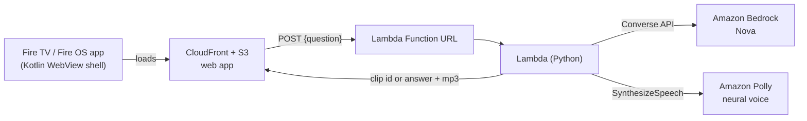

# Fire TV Help Assistant

A voice-and-text help assistant for the Fire TV home screen. When the remote stops responding, a video buffers,
or a setting is hard to find, the viewer asks in plain words (English, Hindi or Hinglish) and a friendly on-screen
avatar answers: either with a short recorded walkthrough of the exact steps, or with a freshly generated spoken answer.

Built for the **Amazon Developer Hackathon, Fire TV track** (AI-enhanced viewing, multi-modal UX), with an
entry for the **AWS Builder** and **Open Source** mini challenges.

## What it does

- Fire TV style home screen with a **Press and ask** button, a Search screen with an on-screen keyboard, and a mock remote and player.
- **Ask anything**: type with the on-screen keyboard (or speak where the Web Speech API is available).
  The question goes to an AWS Lambda function.
  - If it matches one of 12 recorded tutorials (Wi-Fi, buffering, remote pairing, parental controls, subtitles, ...), the app plays that tutorial.
  - Otherwise the model writes a short answer that is spoken with Amazon Polly while the avatar plays a speaking animation.
- Works with the **Fire TV remote**: D-pad, Select, **Back** (closes the open panel first, leaves the app only when nothing is open) and **Menu** (opens the help list).
- **If Bedrock is not reachable** the backend falls back to keyword matching and a few scripted answers, so the app never goes silent.

## Architecture

| Folder | What is in it |
|---|---|
| `web/` | The single-page app (`index.html`), avatar clips go next to it. See `web/README.md`. |
| `backend/` | `lambda_function.py`, the IAM policy, `DEPLOY.md` (step by step) and offline unit tests. |
| `android/` | The Kotlin shell that runs the web app full screen on Fire OS and forwards Back and Menu. |
| `docs/` | Friction log for the hackathon. |

## AWS services used

- **Amazon Bedrock** (Converse API, Amazon Nova): decides whether a question matches a recorded tutorial or needs a new answer, and writes the answer. The prompt tells the model to ignore instructions hidden in the viewer's text.
- **Amazon Polly** (neural voices, English and Hindi): speaks generated answers.
- **AWS Lambda** (Function URL): the backend.
- **Amazon S3 + CloudFront**: host the web app and the avatar clips.

## Run it

1. **Backend**: follow `backend/DEPLOY.md` (about 15 minutes). Run the offline tests with
   `python -m unittest backend/test_lambda.py` (no AWS account needed).
2. **Web app**: copy the avatar clips next to `web/index.html`, copy `web/config.example.json` to `web/config.json`
   and put your Function URL in it. Try it locally with `python -m http.server` inside `web/`, then upload the folder to S3 behind CloudFront.
3. **Fire TV shell**: follow `android/README.md` and run on the Android Studio **Television (1080p), API 30** emulator
   (Android 11, the base of Fire OS 8) or on a Fire OS device.

## Current status and known limits

- Tested on the Android Studio Television emulator (API 30) and in desktop Chrome. Not yet tested on a physical Fire TV device.
- The avatar uses recorded video clips. While an answer is spoken, a looping speaking animation plays; it is **not** word-level lip-sync.
- Speech input uses the browser's Web Speech API, which may not be available inside every WebView. Typing with the on-screen keyboard always works.
- The Bedrock model path is implemented and unit tested with fakes. On the account used for the hackathon, the Bedrock quotas
  were 0 (increase requests were still pending), so live demos used the built-in fallback. See `docs/FRICTION_LOG.md`.
- The Function URL uses auth type NONE for the demo. For real use put it behind IAM auth or API Gateway with throttling, and set an AWS Budget alert.
- Film posters in the demo rows are loaded from public YouTube thumbnails and are placeholder content.

## License

MIT, see `LICENSE`.
